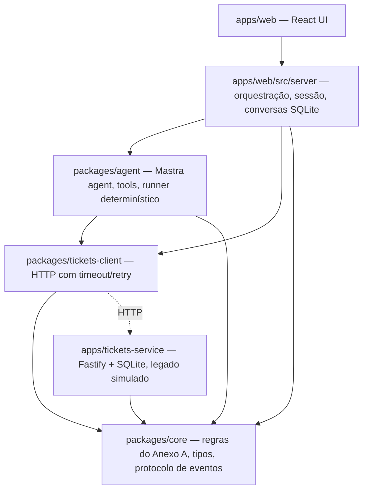
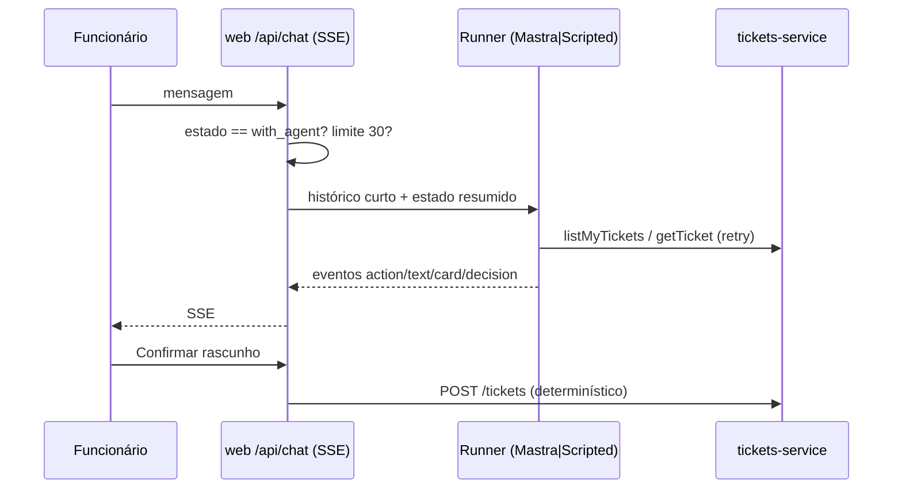

# Architecture Spine — Nexo Assist

## Design Paradigm

Camadas com núcleo de domínio puro. Cada camada só depende das de baixo.



## Invariants & Rules

### AD-1 — O LLM decide, o código executa efeitos com confirmação
- **Binds:** FR14, FR15, AA4
- **Prevents:** chamado criado/alterado sem confirmação ou por alucinação.
- **Rule:** tools do LLM só leem dados, montam rascunhos (`draftTicket`, `draftTicketUpdate`) ou pedem transferência. Criar, comentar e reabrir chamado acontecem apenas em `POST /api/conversations/:id/draft/confirm`, código determinístico.

### AD-2 — Regras do Anexo A vivem em `packages/core`
- **Binds:** FR13–FR16, AA12–AA17
- **Prevents:** regra divergente entre prompt, agent, serviço e UI.
- **Rule:** prioridade (impacto × urgência), prazo em horas úteis, "vencido", janela de reabertura (7 dias) e detecção de duplicidade são funções puras e testadas em `core`; prompt apenas descreve, nunca recalcula.

### AD-3 — Identidade nunca é argumento de tool
- **Binds:** FR18, AA10, E5
- **Prevents:** o modelo consultar chamados de outro funcionário.
- **Rule:** tools são criadas por turno com o e-mail da sessão em closure; o serviço de chamados sempre filtra por `requester` e responde 404 para chamado de outra pessoa.

### AD-4 — Um protocolo de eventos para os dois runners
- **Binds:** FR4–FR7, NFR5
- **Prevents:** UI que só funciona com o Gemini real.
- **Rule:** `MastraRunner` (Gemini) e `ScriptedRunner` (determinístico) emitem os mesmos `AgentEvent` definidos em `core/events.ts` (`action`, `text`, `card`, `decision`, `transfer`, `error`). A UI e os testes consomem apenas esse protocolo.

### AD-5 — Toda resposta do agent carrega uma decisão
- **Binds:** FR5, FR6, B7
- **Prevents:** resposta sem explicação.
- **Rule:** o agent chama `recordDecision` (entendeu, intenção, ação, confiança 0–1, porquê) em todo turno. Se não chamar, o orquestrador sintetiza a decisão a partir do rastro com confiança 0,4. Confiança < 0,5 sem transferência → transferência automática com motivo `low_confidence`.

### AD-6 — Estado da conversa é a trava do agent
- **Binds:** FR22, FR25, AA9
- **Prevents:** agent respondendo durante atendimento humano.
- **Rule:** `conversation.state ∈ {with_agent, waiting_analyst, with_analyst, closed}`. O orquestrador só invoca o runner em `with_agent`; demais estados apenas persistem a mensagem.

### AD-7 — Cada serviço é dono do próprio banco
- **Binds:** NFR2, T5
- **Prevents:** dois donos da mesma entidade.
- **Rule:** `tickets-service` é dono de chamados e eventos (`data/tickets.db`); `web` é dono de usuários, conversas, mensagens, rascunhos e estado (`data/web.db`). Ninguém lê o banco do outro; comunicação só via HTTP.

### AD-8 — Falhas do legado são esperadas
- **Binds:** FR20, L1
- **Prevents:** erro cru na tela quando o legado oscila.
- **Rule:** `tickets-client` usa timeout de 3 s e até 3 tentativas com backoff para 5xx/timeout; cada nova tentativa vira evento `action` visível ("serviço de chamados instável, tentando de novo"); falha final vira `TicketsUnavailableError` tratada com mensagem amigável.

## Consistency Conventions

| Concern | Convention |
| --- | --- |
| Naming | Código em inglês; textos de UI e mensagens em português. Chamados `INC-NNNNN` / `REQ-NNNNN`. |
| Datas | ISO 8601 UTC no armazenamento e na API; formatação pt-BR (America/Sao_Paulo) só na UI. |
| Erros HTTP | `{ error: { code, message } }`; 404 para chamado inexistente ou alheio. |
| Validação | zod nas bordas (rotas HTTP, inputs de tool). |
| Config | Só via env (`.env`); `.env.example` documenta tudo. Chave do Gemini nunca logada. |
| Auth | Cookie de sessão assinado (HMAC) com e-mail e papel. |

## Stack

| Name | Version |
| --- | --- |
| Node.js | 24 (usa `node:sqlite` embutido) |
| pnpm workspaces | 11 |
| TypeScript | 5.9 (`strict`) |
| Next.js / React | 16 / 19 |
| Mastra (`@mastra/core`) | 1.x |
| `@ai-sdk/google` | 4.x |
| Modelo padrão | `gemini-3.5-flash-lite` (env `GEMINI_MODEL`) |
| Fastify | 5.x |
| zod | 4.x |
| Vitest | latest |

## Structural Seed

```text
apps/
  web/                 # Next.js: telas, rotas /api, orquestração do chat, SQLite de conversas
  tickets-service/     # Fastify: API do legado simulado, falhas injetáveis, SQLite de chamados
packages/
  core/                # domínio: tipos, prioridade/SLA, duplicidade, eventos, rótulos
  tickets-client/      # cliente HTTP com timeout/retry
  agent/               # Mastra agent, tools, prompt, central de ajuda, ScriptedRunner
```



## Deferred

- Deploy público (opcional, sem custo previsto).
- Push em tempo real para o console (polling de 3 s basta para o desafio).
- Feriados no cálculo de horas úteis.
